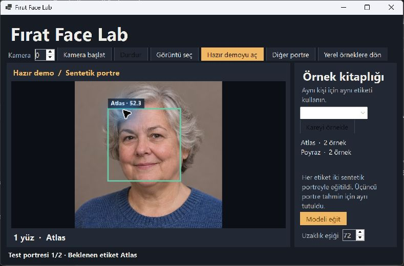
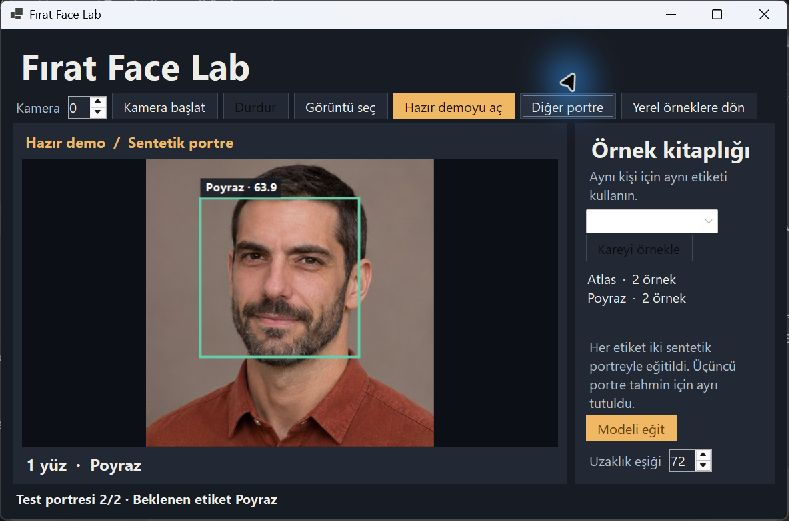

# Fırat Face Lab

Bir fotoğrafta veya kamera karesinde yüzün konumunu bulup dikdörtgen çizen ve az sayıda yerel örnekle etiket tahmini yapan YMH219 uygulaması. Algılama bir yüzün nerede olduğunu, tanıma ise eğitilmiş örneklerden hangisine benzediğini gösterir.

**Öğrenci** · Mustafa Alkhatta, 250541607

## Çalıştırma

Windows 10/11 x64 ve .NET 10 SDK gereklidir. Visual Studio .NET masaüstü iş yüküyle `FaceRecognition.csproj` açılabilir.

```powershell
git clone https://github.com/MustafaAlkhattab/YMH219-FaceRecognition.git
cd YMH219-FaceRecognition
dotnet run -c Release
```

## Hazır demo

**Hazır demoyu aç** iki kurgusal sınıfı ikişer görüntüyle eğitir ve eğitimde bulunmayan bir test portresinin sonucunu gösterir. **Diğer portre** ikinci etiketi sınar. Demo sentetik görüntüler kullanır, kayıtlı kişisel örneklere dokunmaz ve kamera gerektirmez. Programı doğrudan demoda başlatmak için `dotnet run -c Release -- --demo` kullanın.

## Yerel örnekle çalışma

1. **Görüntü seç** ile bir fotoğraf açın veya **Kamera başlat** seçeneğini kullanın. **Durdur** son kareyi ekranda tutar.
2. Bir etiket girin veya kitaplıktan seçin ve **Kareyi örnekle** düğmesine basın. Örnek karede tek yüz olmalıdır. Aynı kişinin farklı karelerini **aynı etiket** altında toplayın.
3. Toplam iki örnekle **Modeli eğit** etkinleşir. İki farklı etiket sınıflandırma, tek etiket altında iki kare ise tek kişi eşleşme denemesi sağlar. Her sınıf için farklı açı ve aydınlatmada en az üç kare önerilir.
4. Yeni bir fotoğraf veya karede tahmin edilen etiketi okuyun. LBPH **uzaklığı** düştükçe eşleşme artar. Eşiği aşan tahmin **Bilinmiyor** olarak gösterilir.

Yüz örnekleri `%LOCALAPPDATA%\YMH219-FaceRecognition\training` altında saklanır. Kamera video kaydı yapılmaz. Kullanıcının izni olan örnekleri yerel tutun. Eğitilen model oturum belleğindedir ve uygulama yeniden açıldığında yerel örneklerle tekrar eğitilebilir.

## Teknoloji ve sınıflar

C# / .NET 10, Windows Forms, OpenCvSharp4.Windows ve OpenCvSharp4.Extensions 4.11.0.20250507. `FaceLab` Haar ile yüzü algılar, kareyi griye çevirip 160×160 piksele normalleştirir ve LBPH modeline yerel etiketleri verir. `LabWindow` örnek kitaplığını, kamera ve dosya girişlerini, tahminleri ve hata durumunu gösterir. Haar modeli OpenCV ile birlikte dağıtılır. [OpenCV Haar modeli kaynağı](https://github.com/opencv/opencv/blob/4.11.0/data/haarcascades/haarcascade_frontalface_default.xml)

## Ekran görüntüleri




## Doğrulama ve sınırlamalar

Windows Release derlemesi, iki ayrı sentetik test portresindeki etiketler, her sınıfta bir örnekle eğitim ve bir sınıfta iki örnekle eğitim doğrulandı. LBPH uzaklığı olasılık değildir. Açı, aydınlatma, çözünürlük ve benzer iki yüz sonucu etkiler. Bu uygulama bir kimlik doğrulama veya güvenlik sistemi olarak tasarlanmamıştır.

[Sentetik örneklerin kaynağı ve üretim istemi](demo/README.md)
